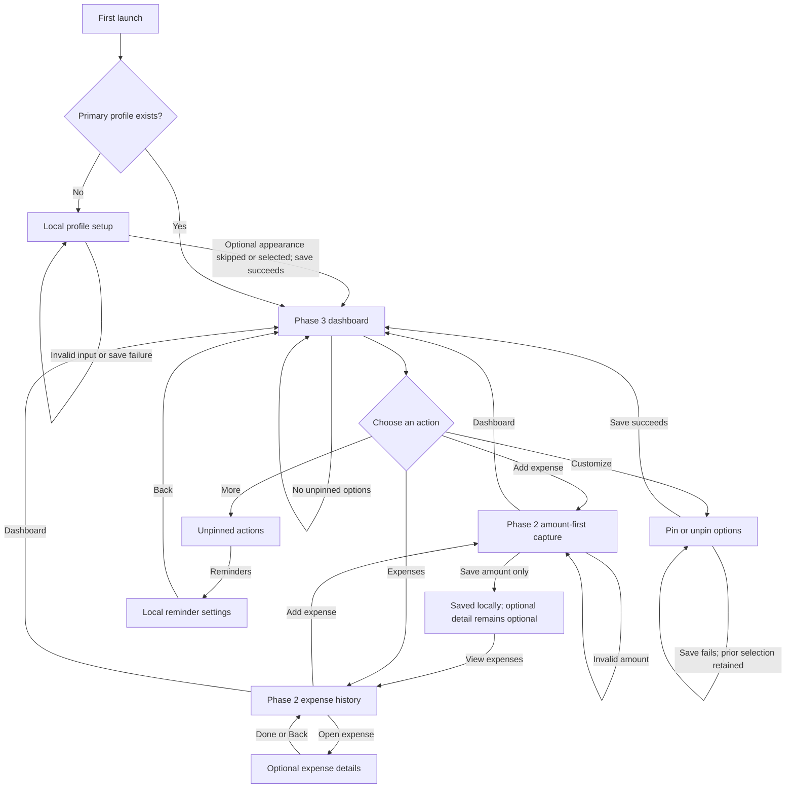

# NestVest User Journeys

Cross-feature paths assembled from current feature specifications, mockups, and
repository implementation evidence. Status means implementation evidence in this
repository, not a claim that a build has shipped.

## Journey inventory

| Actor | Trigger and entry | Screens/actions and decisions | Exit, return, and recovery | Feature status and sources |
|---|---|---|---|---|
| New primary user | First app launch with no saved profile | Complete local profile setup; name and currency are required; appearance is optional; a failed save offers retry. On successful profile load/save, the current app route enters expense capture. | Continue into the app; retry a failed operation; profile remains local. | **Implemented in repository.** [Phase 1 spec](../../specs/001-local-profile-foundation/spec.md), [mockup](../../specs/001-local-profile-foundation/ui-mockups.html), [ProfileRoute.kt](../../app/src/main/java/com/nestvest/profile/ui/ProfileRoute.kt), [MainActivity.kt](../../app/src/main/java/com/nestvest/MainActivity.kt). |
| Returning expense user | App opens with a saved profile | Current route opens amount-first expense capture. Save requires only an amount; optional details can be deferred. Expense history opens separately; reminder entry is available from history. | Keep capturing, open history, review/edit details, or return to capture. A reminder deep link also requests capture. | **Implemented in repository; current launch behavior is the continuity baseline.** [Phase 2 spec](../../specs/002-daily-expense-capture/spec.md), [mockup](../../specs/002-daily-expense-capture/ui-mockups.html), [ExpenseRoute.kt](../../app/src/main/java/com/nestvest/expense/ui/ExpenseRoute.kt), [ExpenseViewModel.kt](../../app/src/main/java/com/nestvest/expense/ui/ExpenseViewModel.kt), [MainActivity.kt](../../app/src/main/java/com/nestvest/MainActivity.kt). |
| Returning NestVest user (proposed) | App launch after Phase 3, or successful first profile setup | New dashboard presents pinned actions; **Add expense** opens the existing amount-first capture; **Expenses** opens the existing history; **More** lists unpinned actions such as reminder settings; **Customize** pins/unpins actions. | Return to dashboard from a module; keep all available options accessible; failed customization leaves prior preferences intact. | **Mockup-only proposal.** [Phase 3 spec](../../specs/003-dashboard-navigation/spec.md), [mockup](../../specs/003-dashboard-navigation/ui-mockups.html). |

## End-to-end proposed flow

## Integration notes

- Dashboard is proposed as the app starting point after profile setup and for returning
  users, per the user's accepted mockup choice. This is a change from the current
  implementation, where `ExpenseViewModel` defaults to `CAPTURE` and `MainActivity`
  composes `ExpenseRoute` after profile resolution.
- The dashboard's **Add expense** action provides a direct route to the existing
  amount-first keypad. Saving still requires no category, vendor, or receipt; optional
  details remain skippable. Expense history and reminders retain their current
  terminology and local-only behavior.
- The existing reminder notification deep link currently requests expense capture
  directly. Its dashboard interaction is not changed or simulated by this mockup.
- Future planning, wealth, and family modules are not represented as available actions
  until their implementations exist.
